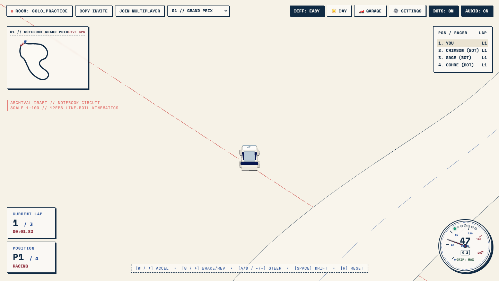
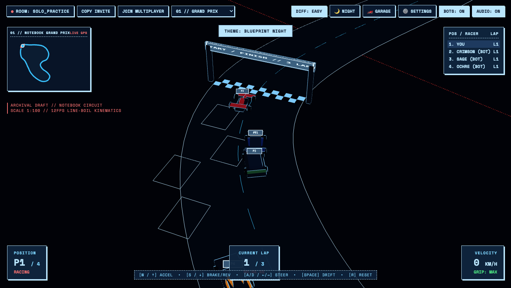
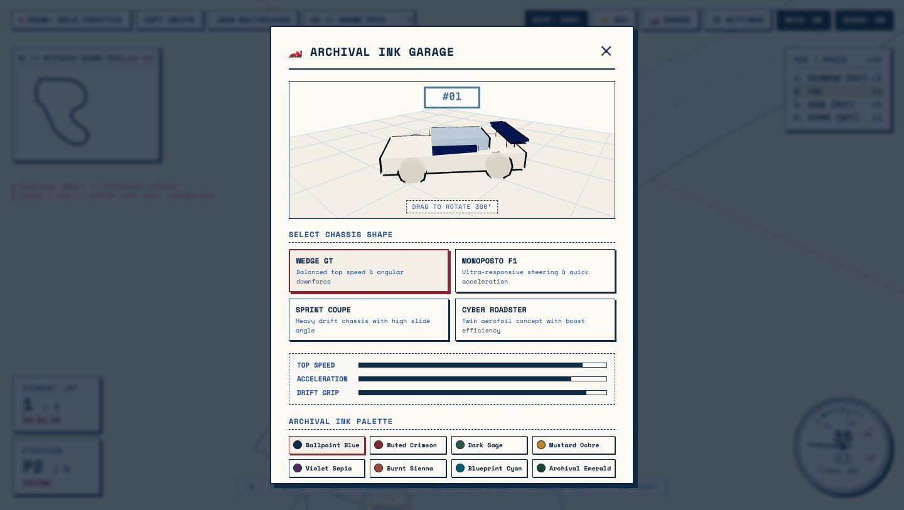
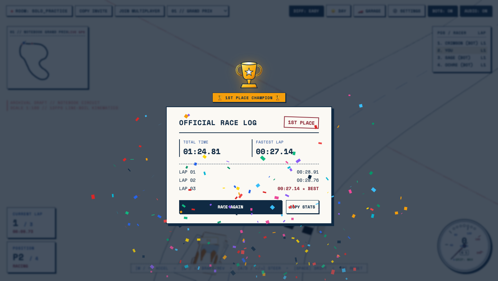
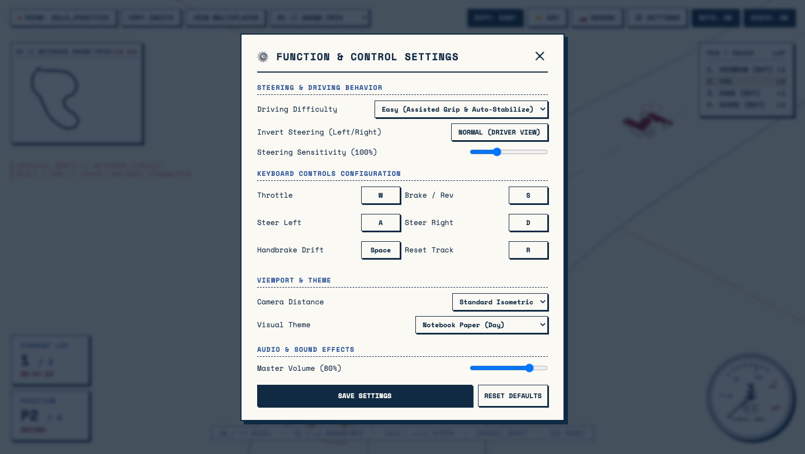

# 🏎️ INK DRIFT // Real-Time Isometric Arcade Racer

> A lightweight, highly optimized, real-time multiplayer isometric arcade racing game crafted with a distinct **"blue ballpoint pen sketch on lined/graph notebook paper"** aesthetic.
> Runs smoothly in modern desktop and mobile web browsers at 60fps with zero external asset downloads.

[](https://vikramlingam.github.io/ink-drift/)
[](https://github.com/vikramlingam/ink-drift)
[](#tech-stack)
[](#aesthetic--art-direction)
[](#)

---

## 📸 Visual Showcase

### 1. Daylight Notebook Racing & Blueprint Night Mode
| ☀️ Archival Notebook Paper (Day) | 🌙 Blueprint Cyan Glow (Night) |
| :---: | :---: |
|  |  |
| *Cream drafting paper (`#FBF9F4`), fine cyan graph grid, crimson margin guide, and live translucent GPS minimap.* | *Dark archival blueprint (`#0A192F`), forward headlight projection beams on the asphalt, and glowing cyan pen outlines.* |

---

### 2. Archival Ink Garage & 1st Place Victory Celebration
| 🏎️ 3D Turntable Garage Studio | 🏆 Victory Celebration & Race Recap |
| :---: | :---: |
|  |  |
| *Interactive 360° drag-to-spin turntable, 4 chassis silhouettes, live performance spec bars, and 8 archival ink palettes.* | *1st Place finish celebration with an ink-etched Golden Trophy cup, full-screen confetti cannon burst, and detailed lap log.* |

---

### 3. Function & Control Settings Modal
<p align="center">
  
  <br />
  <em>Complete keyboard rebinding, steering invert toggle, sensitivity tuning (50%–200%), camera distance, and 3-tier driving physics.</em>
</p>

---

## 🏆 Key Features

- **Distinctive Notebook & Blueprint Art Style:**
  - Aged cream notebook paper ground with GPU procedural tooth grain.
  - Fine-ruled cyan/grey graph grid with a single vertical crimson margin guide line.
  - Low-poly minimalist cars and circuits rendered with unlit paper-fill inside faces and crisp inverted-hull ballpoint pen outlines.
  - Synchronized stop-motion flipbook line-boil tremor.
  - Real-time ballpoint pen skidmarks left on the paper during high-slip drifts.
- **5 Flat-Level Circuits (Zero High Slopes):**
  - **01 // Notebook Grand Prix (650m):** High-speed main straight, sweeping 180° carousel, and tight chicane.
  - **02 // Oval Speedway (520m):** High-speed superspeedway test loop designed for drift chaining.
  - **03 // Alpine Ink Pass (740m):** Technical course with alternating S-bends and blind corners.
  - **04 // Infinity Crossover (680m):** Figure-8 crossover track with intersecting apexes.
  - **05 // Tokyo Blueprint Bay (630m):** Coastal street circuit featuring sharp 90-degree squared corners.
- **Day & Night Themes:**
  - **Day:** Warm cream paper (`#FBF9F4`) with deep ballpoint blue ink.
  - **Night:** Deep cyanotype blueprint paper (`#0A192F`) with forward headlight projection beams on the road and glowing cyan pen outlines.
- **Translucent GPS Minimap:**
  - Corner HUD displaying the full circuit ribbon, start/finish line tick, player heading arrow, and opponent positions in real time.
- **3 Driving Difficulty Levels:**
  - **EASY (Assisted):** High tire grip (+5%), active auto-stabilization against spin-outs, forgiving drift recovery. AI opponents drive at a relaxed pace with human-like imperfections and yield leads dynamically.
  - **MEDIUM (Balanced Arcade):** Fast steering response with authentic arcade drift initiation and recovery.
  - **HARD (Pro Racer):** Tight grip envelope, raw physics, high top speed, requiring throttle feathering and counter-steering.
- **Interactive 3D Garage Studio:**
  - 4 Car chassis styles: *Wedge GT*, *Monoposto F1*, *Sprint Coupe*, *Cyber Roadster*.
  - 8 Archival ink palettes: *Ballpoint Blue*, *Muted Crimson*, *Dark Sage*, *Mustard Ochre*, *Violet Sepia*, *Burnt Sienna*, *Blueprint Cyan*, *Archival Emerald*.
  - Custom decal numbers with 360° drag-to-spin turntable preview.
- **Victory Celebration:**
  - 1st Place finishes trigger an ink-etched Golden Trophy Cup and full-screen colorful confetti burst.
- **Serverless Multiplayer:**
  - Instant matchmaking via Playroom Kit (`joinPlayroom`, `insertCoin`) with room codes and URL sharing (`?room=XYZ`).
  - 20Hz compressed state packets with Hermite snapshot interpolation and dead reckoning.
  - Ghost/draft soft elastic collisions preventing ping glitches or physics clashing.
- **Procedural Web Audio API:**
  - 100% synthesized sound: pitch-modulating engine oscillator, bandpass paper-friction drift screech, checkpoint chimes, and finish fanfare chords. Master volume control.

---

## 🕹️ Controls

### Desktop Keyboard
| Action | Default Key | Rebindable? |
| :--- | :--- | :---: |
| **Accelerate** | `W` or `↑` | ✅ Yes |
| **Brake / Reverse** | `S` or `↓` | ✅ Yes |
| **Steer Left** | `A` or `←` | ✅ Yes |
| **Steer Right** | `D` or `→` | ✅ Yes |
| **Handbrake Drift** | `SPACEBAR` | ✅ Yes |
| **Reset to Track** | `R` | ✅ Yes |

*All keyboard bindings can be customized anytime via the **⚙️ SETTINGS** menu.*

### Mobile Touchscreen
- **Virtual Thumbstick (Bottom-Left):** Smooth analogue steering with auto-centering
- **Gas Pedal (Bottom-Right):** Forward acceleration
- **Brake / Drift Pedal (Bottom-Right):** Quick braking and drift initiation

---

## ⚙️ Settings & Configuration
Click **⚙️ SETTINGS** in the top bar to configure:
1. **Driving Difficulty:** Easy / Medium / Hard
2. **Invert Steering:** Toggle Normal (Driver View) vs Inverted
3. **Steering Sensitivity:** 50% to 200%
4. **Key Rebinding:** Click any control action and press your desired key
5. **Camera Presets:** Close-Up View, Standard Isometric, Panoramic Far
6. **Visual Theme:** Notebook Paper (Day) or Blueprint Cyanotype (Night)
7. **Master Volume:** 0% to 100% slider

---

## 🚀 Getting Started

### Installation
```bash
# Clone the repository
git clone https://github.com/vikramlingam/ink-drift.git
cd ink-drift

# Install dependencies
npm install
```

### Local Development Server
```bash
npm run dev
# Server ready on http://localhost:5173/
```

### Production Build
```bash
npm run build
# Compiles optimized bundle to /dist in ~250ms
```

### Preview Production Build
```bash
npm run preview
# Serves /dist on local port
```

---

## 🛠️ Tech Stack & Architecture

- **Rendering Engine:** [Three.js](https://threejs.org/) (r182) with custom GLSL procedural paper shaders, line-boil displacement, and inverted hull edge outlines.
- **Physics Engine:** Custom 60Hz raycast arcade vehicle kinematics with slip angle computation, weight transfer, and soft collision damping.
- **Multiplayer Networking:** [Playroom Kit](https://joinplayroom.com/) serverless peer synchronization with Catmull-Rom snapshot interpolation.
- **Audio:** Web Audio API procedural synthesis (oscillator banks + biquad filtering).
- **Bundler:** Vite 8 with Rolldown tree-shaking for ultra-lightweight delivery.

---

## 📄 License
MIT License. Built with ❤️ for arcade racing and archival sketch aesthetics.
